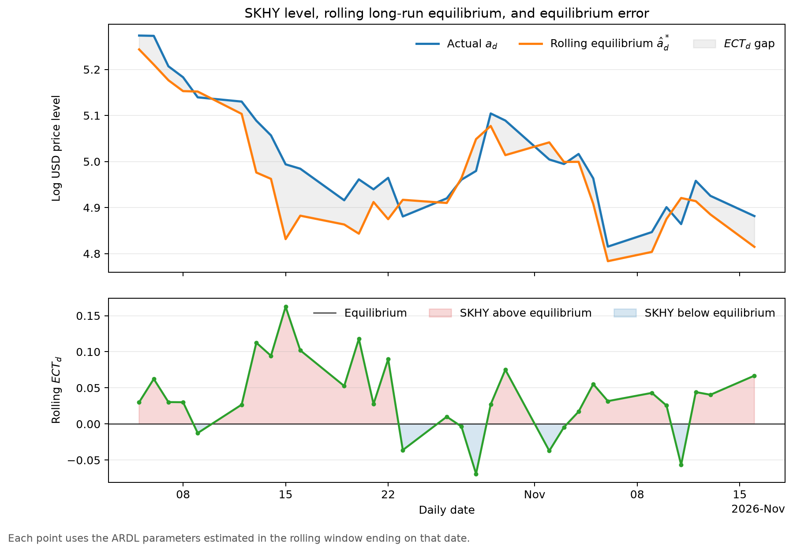

# H1: Estimate the long-run equilibrium using daily ARDL

## Variables

For paired daily observations, define:

\[
a_d=\ln P^{SKHY}_d,\qquad
k_d=\ln\left(\frac{P^K_d}{10FX_d}\right).
\]

$$P^K_d$$ is the Korean ordinary-share close in KRW and $$FX_d$$ is KRW per USD, both observed at the Korean close. The factor `10` implements the 0.1 ordinary share per SKHY ADS ratio. In the pre-open forecasting panel, $$P^{SKHY}_d$$ is the latest completed SKHY regular-session close, so the level relationship is known before the next U.S. open.

## Unrestricted error-correction  model

Estimate the daily UECM:

\[
\boxed{
\begin{aligned}
\Delta a_d={}&c+\rho_a a_{d-1}+\rho_k k_{d-1}\\
&+\sum_i\phi_i\Delta a_{d-i}
+\sum_j\gamma_j\Delta k_{d-j}\\
&+\boldsymbol\delta'Z_d+\varepsilon_d.
\end{aligned}
}
\]

The implementation always includes the contemporaneous $$\Delta k_d$$, searches lag orders for lagged $$\Delta a$$ and $$\Delta k$$, and selects `(p,q)` by BIC.
$$Z_d$$ is optional and must contain only controls available at date `d`.

## Long-run equilibrium and equilibrium error

The UECM constant is not itself the equilibrium intercept. Setting differences and the disturbance to zero gives:

\[
\boxed{a_d^*=\hat c_{LR}+\hat\theta k_d},\qquad
\hat c_{LR}=-\frac{\hat c}{\hat\rho_a},\qquad
\hat\theta=-\frac{\hat\rho_k}{\hat\rho_a}.
\]

The important SKHY output is therefore:

\[
\boxed{ECT_d=a_d-\hat a_d^*}.
\]

The code reports the raw UECM constant as `uecm_constant` and the derived long-run constant as `intercept`, preventing the two quantities from being confused. A positive ECT means SKHY is above its estimated daily equilibrium.

## Cointegration inference

The bounds F statistic tests the joint null:

\[
H_0:\rho_a=\rho_k=0.
\]

The primary finite-sample comparison uses Narayan (2005) Case III critical values for one-level regression when the effective sample size is supported. The result is classified as cointegrated, no cointegration, or inconclusive according to whether the statistic lies above, below, or inside the bounds. Unsupported sample sizes are labelled explicitly; the code does not relabel asymptotic values as Narayan values. As a robustness check, the implementation simulates independent random-walk level series under the null, retains the selected short-run lag structure, and reports an empirical bootstrap p-value and 10%, 5%, and 1% critical values. The ordinary OLS F-test p-value is stored for diagnostics but is not treated as valid bounds-test inference.

## Stability analysis

`rolling_stability()` re-estimates H1 on fixed daily windows and records:

- the long-run slope `theta`;
- the equilibrium `intercept`;
- `rho_a` and `rho_k`;
- the selected `(p,q)` orders; and
- residual persistence, estimated as the AR(1) coefficient of the window ECT.

Large shifts in the slope or intercept, or residual persistence approaching
one, are evidence that a single full-sample equilibrium may not be stable.
Rolling estimates are supplementary diagnostics and do not use future data in the expanding-window H2 forecasts.

## Current H1 test results

These results use the current 90-row daily panel from **2026-07-13 through
2026-11-16**, lag orders up to three, BIC selection, no additional controls,
and 499 bootstrap replications with seed `20261123`. After differencing and the
selected lags, the effective estimation sample contains 87 observations.

### Selected UECM and long-run equilibrium

BIC selects `p=1` and `q=1`. The principal estimates are:

| Quantity | Estimate |
| --- | ---: |
| UECM constant | 0.341069 |
| `rho_a` | -0.317417 |
| `rho_k` | 0.267567 |
| Long-run intercept | 1.074514 |
| Long-run `theta` | 0.842952 |
| HAC delta-method standard error of `theta` | 0.087598 |
| HAC delta-method p-value of `theta` | 6.40e-22 |
| UECM R-squared | 0.584260 |
| BIC | -303.808610 |

The selected daily UECM, including every estimated short-run term, is:

\[
\boxed{
\begin{aligned}
\Delta a_d={}&0.341069
-0.317417a_{d-1}
+0.267567k_{d-1}\\
&+0.502195\Delta k_d
-0.203014\Delta a_{d-1}
+0.382002\Delta k_{d-1}
+\boldsymbol\delta'Z_d
+\hat\varepsilon_d.
\end{aligned}
}
\]

| UECM term | Coefficient | HAC standard error | HAC p-value |
| --- | ---: | ---: | ---: |
| Constant | 0.341069 | 0.151841 | 0.024690 |
| `a[d-1]` | -0.317417 | 0.072930 | 1.35e-05 |
| `k[d-1]` | 0.267567 | 0.067903 | 8.13e-05 |
| `Delta k[d]` | 0.502195 | 0.070330 | 9.30e-13 |
| `Delta a[d-1]` | -0.203014 | 0.069962 | 0.003711 |
| `Delta k[d-1]` | 0.382002 | 0.105323 | 0.000287 |

The general specification permits the contemporaneous control vector `Z_d`,
with one estimated coefficient in `delta` for each supplied control. The
reported baseline intentionally supplies no additional controls, so `Z_d` is
empty and `delta'Z_d=0`; all coefficients actually estimated in the current
H1 are displayed above. Controls can be added through the `--controls` option,
provided they were observable on date `d`.

The fitted equilibrium is:

\[
\boxed{\hat a_d^*=1.074514+0.842952k_d}.
\]

The negative estimate of `rho_a` has the convergence sign implied by a stable
error-correction relationship. Its magnitude indicates that approximately
31.7% of a disequilibrium enters the next day's adjustment, conditional on the
included short-run terms. The full-sample ECT has mean 0.000051 and standard
deviation 0.053192.

### Bounds and bootstrap cointegration tests

The bounds-test null is `H0: rho_a = rho_k = 0`, meaning that no long-run level
relationship is present.

| Test quantity | Result |
| --- | ---: |
| Bounds F statistic | 9.474326 |
| PSS 5% lower bound, I(0) | 4.940 |
| PSS 5% upper bound, I(1) | 5.730 |
| PSS 1% upper bound, I(1) | 7.840 |
| Bootstrap 5% critical value | 6.077629 |
| Bootstrap 1% critical value | 10.271014 |
| Bootstrap p-value | 0.016 |

The F statistic exceeds the PSS upper bound even at 1%, so the asymptotic
bounds test rejects the null of no level relationship. The bootstrap statistic
exceeds its 5% critical value but not its 1% critical value; the bootstrap
robustness check therefore rejects the null at 5% (`p=0.016`). Together, the
tests support a cointegrating long-run relationship between the SKHY and
FX-adjusted Korean price levels.

Narayan finite-sample critical values are **not applied to this estimate**.
They are used by the code only for supported small effective samples, whereas
the selected full-sample UECM has 87 observations. The reported primary table
therefore uses the Pesaran--Shin--Smith Case III asymptotic bounds and retains
the bootstrap as the finite-sample robustness check.

### Why the evidence implies long-run cointegration

The conclusion does not follow merely from a significant slope in a static
levels regression. It follows from the level terms in the dynamic UECM:

1. The null `rho_a=rho_k=0` says that lagged price levels do not enter the
   daily adjustment equation, so no long-run equilibrium is identified.
2. The bounds F statistic of 9.474326 is above the 5% I(1) upper bound of
   5.730. The statistic is therefore significant even under the conservative
   assumption that the price levels are I(1), rejecting the no-level-relation
   null.
3. The independently simulated bootstrap null gives `p=0.016` and a 5%
   critical value of 6.077629, confirming the rejection without relying only
   on the asymptotic table.
4. `rho_a=-0.317417` is negative, so a positive deviation of SKHY from its
   equilibrium produces a negative subsequent adjustment. This is the
   convergence mechanism required by an error-correction model.
5. The resulting ECT is mean-reverting: full-sample residual persistence is
   0.453904, and every 60-day rolling estimate remains below one.

Thus, the two price levels may move persistently over time, but the particular
combination `a_d-1.074514-0.842952k_d` is stationary-like, and deviations are
corrected rather than accumulating indefinitely. This is the economic and
statistical meaning of the estimated long-run cointegrating relationship. The
interpretation remains conditional on the standard ARDL requirement that none
of the included series is integrated of order two, I(2), and on the short
sample currently available.

### Rolling stability results

Using 60-observation rolling windows and reselecting lag orders in each window
produces 31 estimates:

| Diagnostic | Mean | Minimum | Maximum |
| --- | ---: | ---: | ---: |
| Long-run `theta` | 0.981947 | 0.866778 | 1.157530 |
| Long-run intercept | 0.415193 | -0.442784 | 0.975906 |
| ECT residual persistence | 0.411473 | 0.239710 | 0.601534 |

For rolling window `w`, the equilibrium and its error are recalculated as:

\[
\hat c_{LR}^{(w)}=-\frac{\hat c^{(w)}}{\hat\rho_a^{(w)}},\qquad
\hat\theta^{(w)}=-\frac{\hat\rho_k^{(w)}}{\hat\rho_a^{(w)}},
\]

\[
\boxed{ECT_d^{(w)}=a_d-\hat c_{LR}^{(w)}-\hat\theta^{(w)}k_d}.
\]

At a forecast origin, window `w` ends on the preceding available date. The
parameters are estimated only through that endpoint and then used to compute
the next ECT, preventing future observations from entering the forecast. The
latest window, **2026-08-24 through 2026-11-16**, selects `p=0, q=0` and gives:

\[
\boxed{ECT_d^{(latest)}=a_d-0.975906-0.866778k_d}.
\]

Its adjustment coefficient is `rho_a=-0.693923`, and its fitted ECT residual
persistence is 0.332361. Across all 31 windows, BIC selects `p=0, q=0` in 24
windows; the remaining windows allow additional short-run lags while retaining
the same rolling long-run transformation.

The rolling slope remains positive but is not constant, ranging from about
0.87 to 1.16. The intercept varies more substantially, while the residual
persistence remains below one in every window. The stability evidence is
therefore mixed: deviations remain mean-reverting throughout the rolling
analysis, but the equilibrium slope and especially its intercept move over
time. H2 should continue to re-estimate H1 at each forecast origin rather than
treat the full-sample equilibrium as permanently fixed.

### Rolling equilibrium plot

The upper panel compares the observed SKHY log-price level with the equilibrium
implied by each 60-session rolling ARDL estimate. Their vertical distance is
the rolling `ECT_d` shown in the lower panel. Repeated movement back toward and
across zero illustrates error correction around a time-varying equilibrium.



## Code and artifacts

The single H1 implementation is `src/hypotheses/h1.py`. Feature construction remains in `src/features/h1_h2.py`; H2 imports the H1 estimator and ECT function instead of defining another level regression.

Run H1 directly with:
```powershell
python -m src.hypotheses.h1 `
  --max-p 3 `
  --max-q 3 `
  --rolling-window 60 `
  --bootstrap-replications 499
```

The default run writes:

| Artifact | Contents |
| --- | --- |
| `h1_model.parquet` | Selected UECM, `rho` coefficients, long-run intercept and `theta` |
| `h1_bounds.parquet` | F statistic, finite-sample bounds decision, bootstrap inference |
| `h1_ect.parquet` | Daily $$a_d$$, $$k_d$$, and estimated equilibrium error |
| `h1_rolling_stability.parquet` | Rolling slope, intercept, lag orders, and residual persistence |
| `reports/h1_rolling_equilibrium.png` | Observed level, rolling equilibrium, and rolling `ECT_d` plot |

